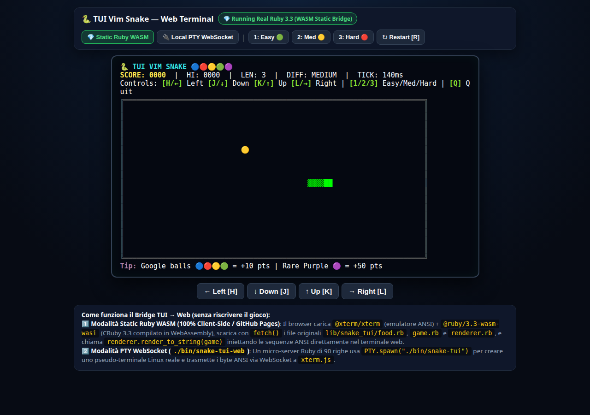

# 🐍 TUI Vim Snake (`snake-tui`)

[](https://github.com/palladius/snake-tui/actions/workflows/pages.yml)

🌐 **Play Live in Browser (CRuby 3.3 WebAssembly + xterm.js):** **[https://palladius.github.io/snake-tui/](https://palladius.github.io/snake-tui/)**



A colorful, nostalgic Nokia-inspired Terminal User Interface (TUI) Snake game written in pure **Ruby** (zero native compilation needed, ideal for headless Linux & Raspberry Pi) built from [`respec`'s `tui-vim-snake` specification](SPEC.md) — plus a **Dual-Engine Web Pseudo-Terminal Bridge** (`xterm.js` + `@ruby/3.3-wasm-wasi` static in-browser VM or native `PTY.spawn` WebSocket).

## ✨ Features

- **Dual Controls (Vim + Arrow Keys):** Move with `H` (Left), `J` (Down), `K` (Up), `L` (Right) OR standard Arrow keys (`←` `↓` `↑` `→`).
- **3 Difficulty Tiers & Countdown:** Toggle `[1]` Easy, `[2]` Medium, `[3]` Hard at any time; starts with a `2... 1...` countdown so you never crash at spawn.
- **Google-Colored Emoji Food:**
  - `🔵` Blue, `🔴` Red, `🟡` Yellow, `🟢` Green (23% each = 92% total) → **+10 points**
  - `🟣` Super Rare Purple ball (8% chance) → **+50 bonus points**
- **Dual-Engine Web Terminal Bridge:**
  - **💎 Static Ruby WASM (GitHub Pages):** Runs the untouched `lib/snake_tui/*.rb` files directly inside your browser via `@ruby/3.3-wasm-wasi` + `@xterm/xterm`.
  - **🔌 Native Ruby PTY WebSocket (`just web`):** Streams the real `./bin/snake-tui` process over a zero-gem RFC 6455 WebSocket + `PTY.spawn` server.
- **Raspberry Pi Friendly:** Pure Ruby standard library (`io/console`, `optparse`, `pty`, `socket`) + `--no-emoji` ASCII fallback for legacy terminals.

## 🚀 Quick Start

```bash
# Play in your terminal
just play

# Launch the local Dual-Engine Web Terminal Bridge (http://localhost:4567)
just web

# Preview a static board frame (--dryrun)
./bin/snake-tui -n

# Fallback for non-emoji terminals
./bin/snake-tui --no-emoji

# Run the TDD test suite
just test
```
